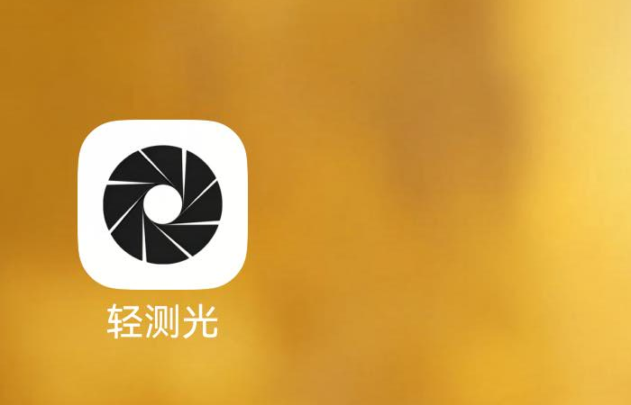
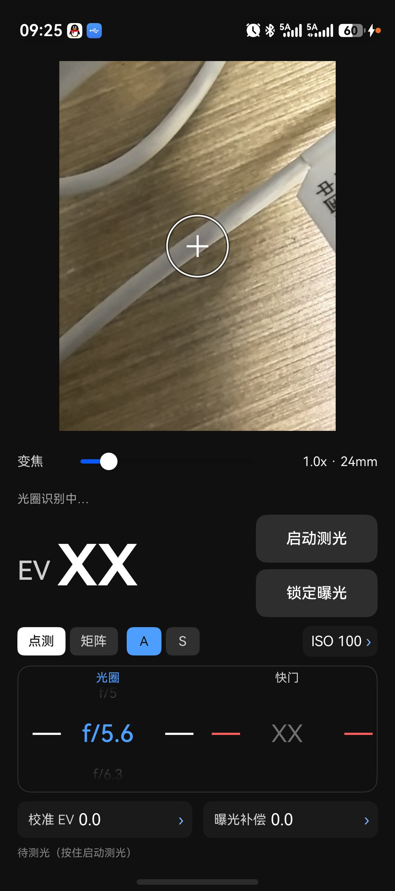
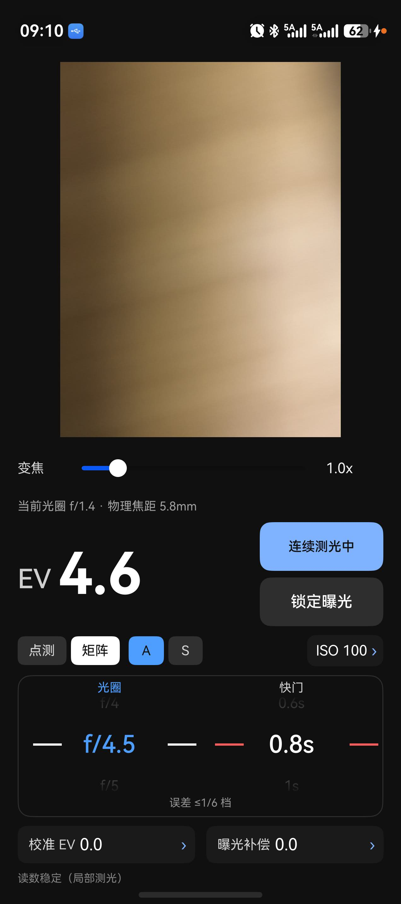
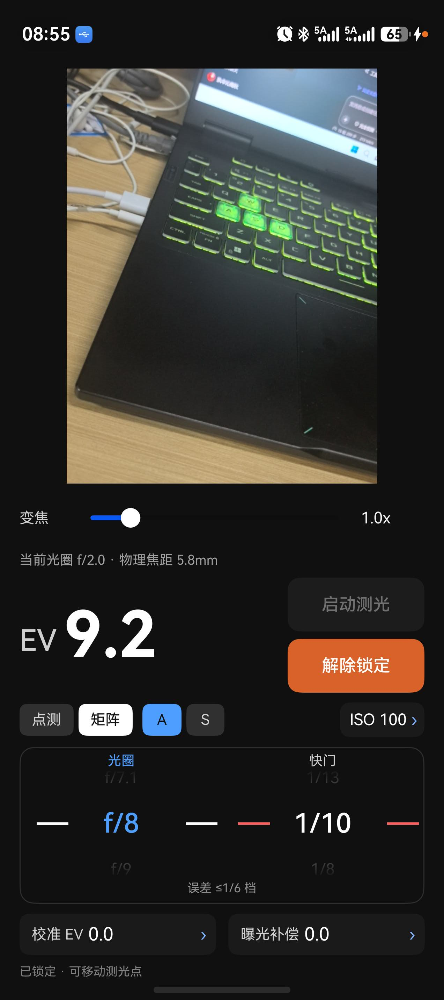
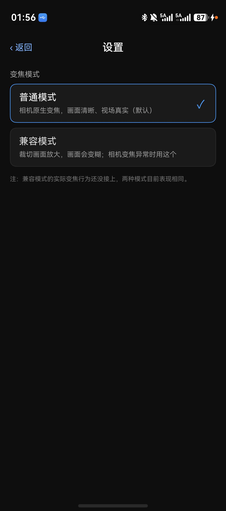

# 轻测光 · Light Meter for HarmonyOS

给胶片摄影师用的鸿蒙原生测光表。用手机相机反算场景的 **EV100**，再换算成胶片机镜头上能拧出来的
光圈 / 快门组合。

> **许可**：[GNU AGPL v3.0](LICENSE) 开源许可 —— 可自由使用、修改、分发（含商业使用），
> 但**任何衍生作品必须同样以 AGPL 开源**，且以网络服务形式提供时必须向用户提供源码（详见文末「许可」）。

<p align="center">
  
</p>

<p align="center">
  
  
  
  
</p>

## 它是怎么测的

手机自动曝光总想把画面压到 18% 灰。既然相机为了做到这点，必须选一组 `ISO / 快门 / 光圈`，
那么反过来用这组参数就能算出场景的反射式测光值：

```
EV100 = log2(N² / t) − log2(ISO / 100)
EV    = EV100 + 2.2 · log2(局部亮度 / 参考亮度) + 校准 + 曝光补偿
```

`N` 是光圈 f 值、`t` 是快门秒数，都来自相机的 AE 回调；局部亮度用第二路低分辨率取帧流自己算，
所以点测圈、矩阵测光的测光区域**会跟着变焦和取景框变化**——这是相机自带的 `SPOT` 模式做不到的。

## 功能

- **按住测光 / 双击连续测光**：默认不测光不拍照（取景最流畅），按住才实时出读数，双击锁存连续测光。
- **锁定曝光**：瞬间定格画面（实测 5~8ms），后台补一张算结果；锁定后仍可切点测/矩阵、拖动测光点。
- **原生变焦**：0.55x ~ 100x 走系统 `setZoomRatio`，滑条两段对数映射；点滑条轨道用平滑变焦。
- **设置页 / 兼容模式**：右上角齿轮可切换「普通模式（真变焦）」与「兼容模式（相机锁最广角 + 裁切放大，
  最多 5x，光圈只读一次、测光只算取景框内的画面）」，给变焦接口异常的机型兜底。
- **焦距按钮**：点「倍数·mm」直接输入等效 35mm 焦距，可锁定焦距（锁定后滑条不可拖，重启保持）。
- **A / S 双档**：A 档锁光圈算快门，S 档锁快门算光圈；超出档位表时滚轮停在首尾的空白档。
- **光圈自动识别**：相机 API 读不到光圈（多数华为机型如此），就用 0.4s 一次的低分辨率静默拍照读 EXIF。
- **支持机型实测**：HUAWEI MRT-AL10 / HarmonyOS 7.0.0.109 / API 26。
- **仓库**：<https://github.com/ZsqNQ/dsh-meter>　|　**下载**：[Releases](https://github.com/ZsqNQ/dsh-meter/releases)

## 安装

- 从本仓库的 **Releases** 页面下载 `qing-ce-guang-vX.Y.Z.hap`（最新 v1.2.1）。
- 该 hap 用**开发者调试证书**签名，一般只能装在已注册设备上；其他设备请自行构建并用你的证书签名：

**推荐**：用 DevEco Studio 打开工程 → 配好签名 → `Build → Build Hap(s)`。

命令行（hvigorw 用 DevEco 自带的那个）：

```bash
ohpm install
export DEVECO_SDK_HOME="<DevEco Studio>/sdk"
export PATH="<DevEco Studio>/jbr/bin:<DevEco Studio>/tools/node:$PATH"
"<DevEco Studio>/tools/hvigor/bin/hvigorw" assembleHap   --mode module -p product=default -p buildMode=release --no-daemon
hdc install -r entry/build/default/outputs/default/entry-default-signed.hap
```

> 工程路径不能含中文（hvigor 会报 `00306003`）。

签名：仓库**不含任何签名材料**。用 DevEco Studio 打开工程 →
File → Project Structure → Signing Configs → 勾选自动生成签名，再构建即可。

## 已知限制

- 光圈读不到时按 EXIF 兜底，个别机型连 EXIF 也不给光圈，此时按 f/2.2 估算（状态栏会提示）。
- 设备跨镜头切换时 EXIF 有 1~2 帧延迟，代码里用「连拍取后一张」规避。
- 只在 MRT-AL10 上验证过；其它机型/系统版本未测试。
- 测光结果未与专业测光表逐档比对，建议用灰卡标定一次「校准 EV」。
- 兼容模式是裁切放大（显示 5x 时实际裁切约 9 倍），画面会明显变糊，适合应急而不是日常拍摄。

## 文档

- [用户手册](docs/USER_GUIDE.md)
- [交接文档（架构 / 踩坑 / 构建发布）](docs/HANDOVER.md)
- [更新日志](CHANGELOG.md)

## 许可

本项目是**开源软件**，采用 **[GNU Affero General Public License v3.0](LICENSE)**（AGPL-3.0）。

- ✅ 可以自由地：使用、修改、分发、**甚至商用**（AGPL 不禁止商业使用）。
- ⚠️ 但必须遵守同一份协议：**你修改后形成的衍生作品，也必须以 AGPL-3.0 开源**，
  不能把本项目改成闭源产品再拿去卖；分发二进制时必须一并提供完整对应源码。
- 🌐 AGPL 的「网络条款」：如果你把它部署成在线服务供他人使用，**必须向使用者提供源码**。
- 📎 分发时请保留本项目的版权声明（`LICENSE` 顶部 `Copyright (C) 2026 南秋 (nanqiu)`）。

> 一句话：它挡住的是「拿去做闭源商业产品」，而不是「商业使用本身」。
> 想基于本项目做**闭源**的产品/服务，需要作者单独的书面授权；如果愿意同样开源，欢迎直接用，无需授权。

著作权自作品完成时即产生，不申请软件著作权登记同样受法律保护；登记只是增强举证。

## 免责声明

测光结果是基于相机自动曝光的**反算估值**，不等同于专业测光表的入射式测量。拍重要片子前请自行验证。
